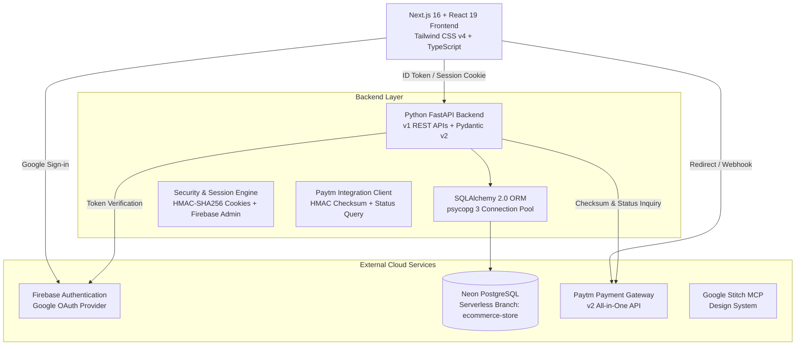

# System Architecture — Aurora Store

## 1. High-Level Architecture Diagram

---

## 2. Component Roles & Communication

### Frontend (Next.js 16 + React 19)
- **Storefront Navigation & Catalog:** Server-side rendered and dynamic client-side catalog browsing, responsive grid layouts, category filtering, search, sorting.
- **Cart Management:** Persistent shopping cart backed by session cookies for guests and database for signed-in customers, with auto-merge on login.
- **Design & Theming:** Modern minimalist aesthetic informed by Google Stitch (`projects/18433139177372353927`). Dark mode with zero flash via pre-mount localStorage script.
- **Image Resilience:** `ImageWithFallback` with skeleton shimmer loaders and category-aware fallback assets.

### Backend (Python FastAPI)
- **Directory:** `backend/`
- **Application Engine:** FastAPI 0.162+ with Pydantic v2 validation and structured logging.
- **Database Engine:** SQLAlchemy 2.0 connected via `psycopg` to Neon Serverless PostgreSQL (`ecommerce-store` branch, `ecommerce` database).
- **Security & RBAC:** Firebase ID token verification, HMAC-signed session cookies, admin role protection.
- **Paytm Service:** Official Paytm payment gateway initiation, HMAC-SHA256 signature verification, and authoritative status reconciliation.

### Database (Neon PostgreSQL)
- **Branch:** `br-hidden-forest-a14nyigq` (`ecommerce-store`).
- **Database:** `ecommerce`.
- **Entities:** Products, ProductImages, ProductVariants, Categories, Carts, CartItems, Orders, OrderItems, Payments, OrderStatusHistory, Wishlists, UserAddresses, Users.

---

## 3. Data Flow Workflows

### Authentication Flow
1. User clicks "Sign in with Google" on frontend.
2. Firebase Web SDK completes Google OAuth popup.
3. Frontend receives Firebase ID token and calls `POST /api/v1/auth/session`.
4. FastAPI validates ID token via Firebase Admin SDK (with public-key cert fallback).
5. FastAPI upserts user record into Neon PostgreSQL `users` table.
6. FastAPI issues an HMAC-signed session cookie (`aurora_session`) with 14-day expiry.
7. Any existing guest cart items are merged into the user's permanent database cart.

### Order & Payment Flow
1. Customer initiates checkout at `/checkout`.
2. Frontend calls `POST /api/v1/checkout` with shipping address and payment method.
3. FastAPI locks product prices from Neon database, validates stock, calculates shipping & taxes.
4. FastAPI persists durable `Order` with `status="pending_payment"`.
5. Frontend calls `POST /api/v1/payments/paytm/initiate` to acquire `txnToken`.
6. Customer completes payment on Paytm interface.
7. Paytm posts callback to `/api/v1/payments/paytm/callback`.
8. Backend verifies signature, validates order ID and amount, queries Paytm `/v5/order/status`.
9. Upon confirmation, backend updates `Order.payment_status = "paid"` and `Order.status = "confirmed"`.
10. Customer is redirected to `/orders/[id]` showing real-time paid status.
